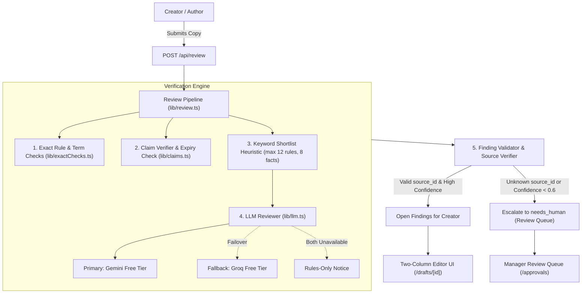
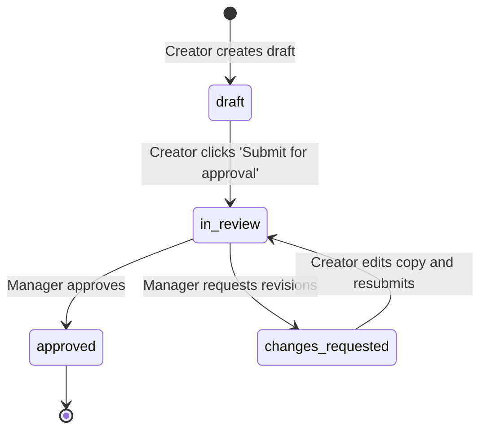

# BrandCite &mdash; System Architecture & Technical Specifications

BrandCite is an enterprise-grade brand governance platform. Creators draft marketing copy, and the system verifies the copy against approved brand rules, approved facts (with strict expiry dates), and preferred/banned terminology. Managers approve or request revisions, and an analytics engine surfaces guideline ambiguity metrics.

---

## 1. High-Level Architecture Overview

BrandCite employs a multi-tier verification pipeline combining deterministic rule-matching with a provider-agnostic Large Language Model (LLM) review layer.

---

## 2. Core Review Pipeline Stages

Every draft review undergoes 5 distinct processing stages:

### Stage 1: Deterministic Exact Checks (`lib/exactChecks.ts`)
- **Banned Terms**: Scans whole words against approved banned terms (e.g. `Nova Brew` &rarr; `NovaBrew`).
- **Preferred Terms**: Flags improper usage of preferred roast names or brand descriptors where preferred replacements are mandated.
- **Structural Rules**: Validates length limits on headlines ($\le 10$ words) and subheadings ($\le 18$ words).
- **Format**: Every exact check finding is deterministic and assigned `confidence: 1.0` and `ai_assisted: false`.

### Stage 2: Claim Verification & Fact Expiration (`lib/claims.ts`)
- Extracts verifiable assertions (environmental claims, awards, sourcing claims, health statements).
- Matches claims against `approved_facts`:
  - **Perpetual Facts (`valid_until: null`)**: Claim is substantiated; no violation flagged.
  - **Active Dated Facts (`valid_until >= today`)**: Claim is valid; no violation flagged.
  - **Expired Facts (`valid_until < today`)**: Flags claim with citation of expired fact ID and expiration date.
  - **Unmatched Claims**: Escalated with `status: needs_human` and `escalation_reason: 'unmatched_claim'` to prevent hallucinations.

### Stage 3: Keyword Shortlisting
- To remain within strict token and context budgets without vector embeddings, BrandCite calculates lexical relevance scores against active brand rules and approved facts.
- At most **12 brand rules** and **8 approved facts** are shortlisted and passed to the prompt context.

### Stage 4: Resilient LLM Layer (`lib/llm.ts`)
- Provider-agnostic chat completions client with zero external SDK lock-in.
- **Failover sequence**:
  1. Primary Provider: Google Gemini API free tier (`gemini-2.5-flash`).
  2. Fallback Provider: Groq Cloud API free tier (`llama-3.3-70b-versatile`).
  3. Graceful Degradation: If both providers fail or timeout, the review engine never crashes; it returns exact checks findings with the banner: `"AI review unavailable, rules-only results"`.
- Every finding produced by the LLM is flagged with `ai_assisted: true`.

### Stage 5: Finding Validation & Escalation Gate
- **Source Verification**: Every finding must cite a valid `source_id` from `brand_rules` (e.g. `R-TONE-01`) or `approved_facts` (e.g. `F-SUST-01`). If the AI invents or hallucinates an unknown source ID, `source_id` is set to `null` and status is set to `needs_human`.
- **Confidence Thresholding**: Any finding with `confidence < 0.6` is automatically assigned `status: needs_human` with `escalation_reason: 'low_confidence'`.

---

## 3. Workflow State Machine

Drafts progress through an approval lifecycle with strict authorization:

- **Transitions**:
  - `draft` &rarr; `in_review`: Only draft author.
  - `changes_requested` &rarr; `in_review`: Only draft author.
  - `in_review` &rarr; `approved` / `changes_requested`: Only managers or admins.
- Every state transition is appended to the immutable `audit_log` table.

---

## 4. Guideline Gap Analytics Formulation (`lib/insights.ts`)

BrandCite measures reviewer consensus to surface potentially ambiguous brand rules:

For each rule $r \in \text{brand\_rules}$:
$$\text{Rejection Rate}(r) = \frac{\text{Times Rejected}(r)}{\text{Times Flagged}(r)}$$

A guideline is flagged as **`possibly_unclear: true`** when:
$$\text{Times Flagged}(r) \ge 3 \quad \text{AND} \quad \text{Rejection Rate}(r) \ge 0.50 \text{ (50\%) }$$

- **Sorting**:
  1. `rejection_rate` descending (highest rejection first).
  2. `times_flagged` descending.
  3. `id` ascending.
- High rejection indicates creators and managers routinely override the finding, signalling the guideline wording is too strict, ambiguous, or poorly aligned with everyday marketing needs.

---

## 5. Data Model & RLS Architecture

Supabase Postgres with Row Level Security (RLS):

| Table | Primary Key | Description & Governance |
| :--- | :--- | :--- |
| `profiles` | `uuid (references auth.users)` | User profile and system role (`creator`, `manager`, `admin`). |
| `brand_rules` | `text (e.g. R-TONE-01)` | Active brand rules. Only `approved = true` rows participate in reviews. |
| `approved_facts` | `text (e.g. F-SUST-01)` | Verified facts with optional expiration date (`valid_until`). |
| `terms` | `uuid` | Banned and preferred terminology. Linked to governing rule. |
| `drafts` | `uuid` | Draft content metadata (`draft`, `in_review`, `changes_requested`, `approved`). |
| `draft_versions` | `uuid` | Immutable snapshots of draft text with sequential version numbering. |
| `findings` | `uuid` | Review issues linked to draft version. Nullable `source_id` on low confidence. |
| `comments` | `uuid` | Threaded discussions between creators and managers. |
| `approvals` | `uuid` | Formal manager sign-off or change request decisions with notes. |
| `audit_log` | `uuid` | Append-only record of all critical events, transitions, and knowledge updates. |

---

## 6. Security & Hardening Boundaries

1. **Input Length Limits**:
   - Draft text & versions: Maximum 5,000 characters (`422 INPUT_TOO_LONG`).
   - Draft titles: Maximum 200 characters (`422 INPUT_TOO_LONG`).
   - Comment bodies: Maximum 2,000 characters (`422 INPUT_TOO_LONG`).
2. **Rate Limiting**:
   - Sliding-window in-memory limiter on `/api/review` (30 requests/min per IP, `429 RATE_LIMIT_EXCEEDED`).
3. **Role Gating**:
   - Creator: View/edit only own drafts.
   - Manager: View all drafts in review, triage human escalation queue, approve/reject drafts, view guideline insights.
   - Admin: Full manager permissions + knowledge base authoring (`/admin/knowledge`).
4. **Error Sanitization**:
   - Every API endpoint returns `{ error: string, code: string }`.
   - Internal database driver errors and stack traces are suppressed in API responses and logged safely to server stderr.

